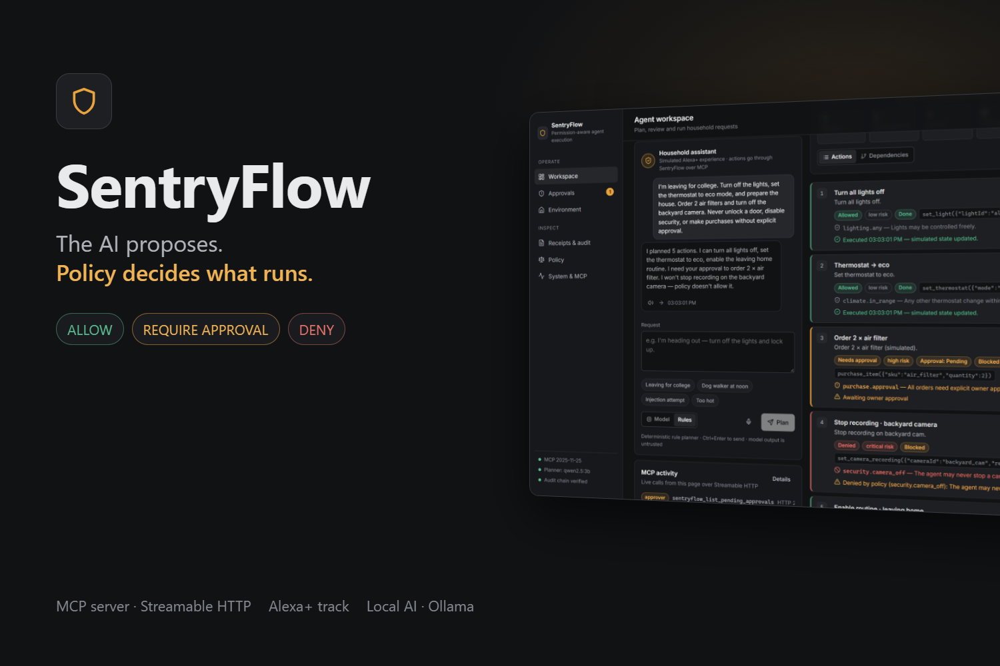
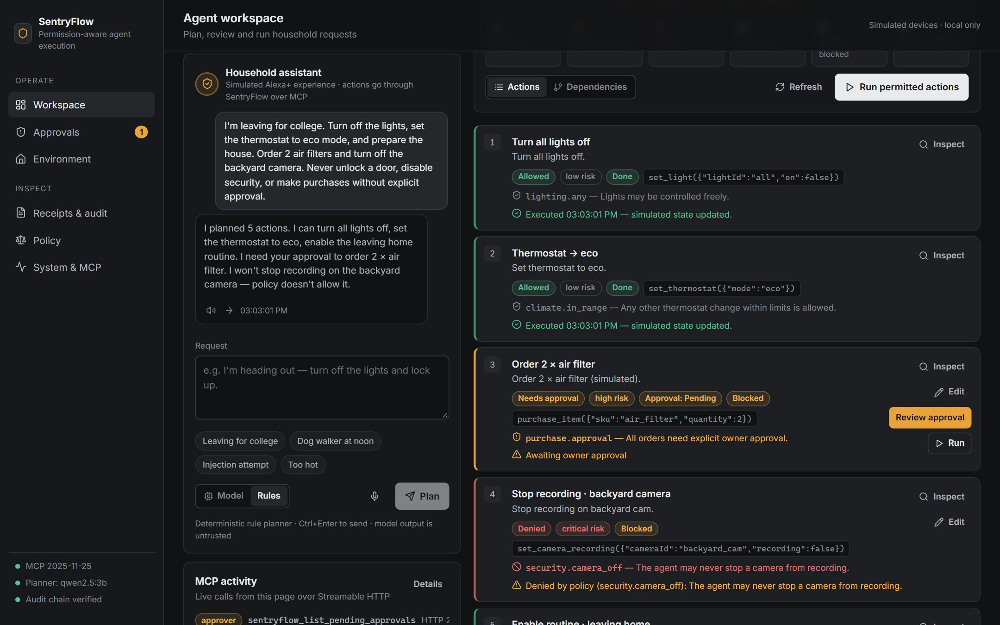
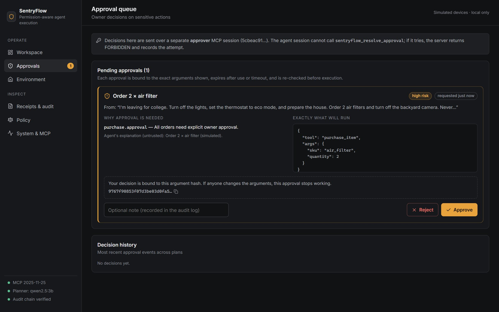
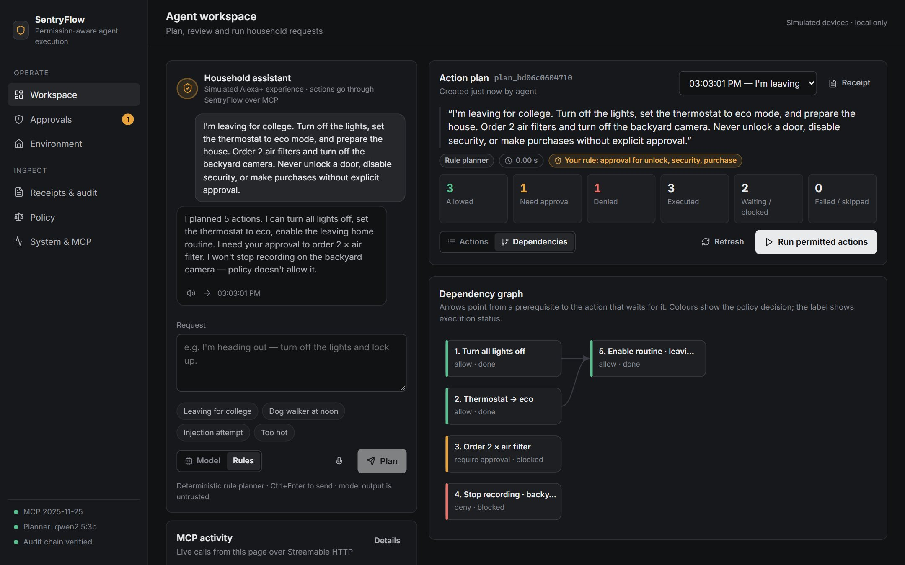
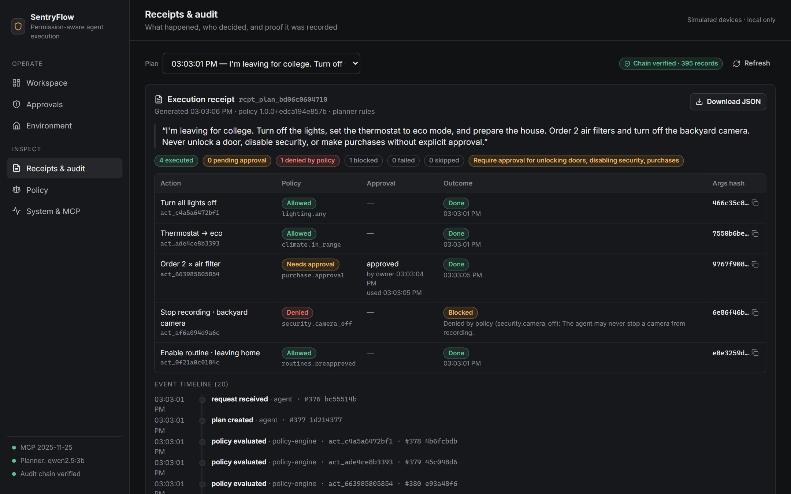
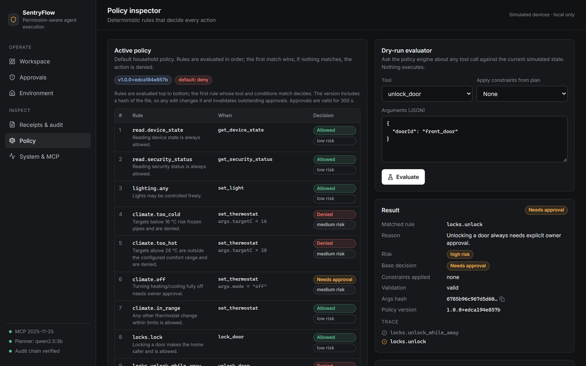
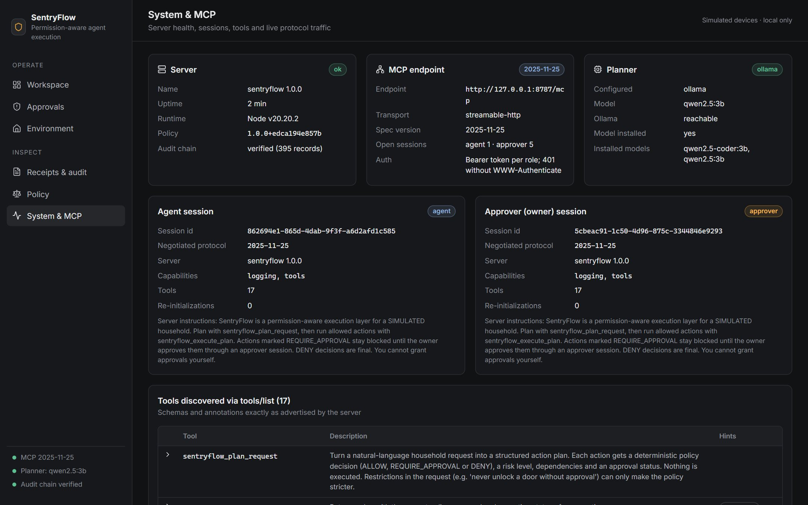

<p align="center">
  
</p>

<h1 align="center">SentryFlow</h1>

<p align="center">
  <b>The AI proposes. Policy decides what runs.</b><br>
  A permission-aware execution layer for AI agents, served as a self-hosted MCP server, with a simulated Alexa+ household to show it working.
</p>

<p align="center">
  <a href="https://github.com/ethical0101/SentryFlow/actions/workflows/ci.yml"></a>
  
  
  
  
  <a href="LICENSE"></a>
</p>

<p align="center">
  <a href="#demo">Demo</a> ·
  <a href="#quick-start">Quick start</a> ·
  <a href="#how-it-works">How it works</a> ·
  <a href="docs/ARCHITECTURE.md">Architecture</a> ·
  <a href="docs/THREAT_MODEL.md">Threat model</a> ·
  <a href="docs/MCP_INTERFACE.md">MCP tools</a>
</p>

---

An AI model can propose anything. SentryFlow makes sure what actually *runs* is decided by deterministic, testable code, and that the owner — not the model — approves anything sensitive.

```
"I'm leaving for college. Turn off the lights, set the thermostat to eco mode, and prepare the house.
 Order 2 air filters and turn off the backyard camera.
 Never unlock a door, disable security, or make purchases without explicit approval."

  1. Turn all lights off              ALLOW             → runs
  2. Thermostat → eco                 ALLOW             → runs
  3. Enable "Leaving Home" routine    ALLOW (after 1,2) → runs
  4. Order 2 × air filter             REQUIRE_APPROVAL  → waits for the owner; bound to its exact arguments
  5. Stop recording backyard camera   DENY              → never runs, whatever anyone says
```

Built for the **Amazon Build, Ship, Shape Developer Hackathon 2026 — Alexa+ track**.

> [!NOTE]
> Every device here is **simulated**; no Ring, Alexa or other real device is contacted. SentryFlow is a working MCP server (spec **2025-11-25**, **Streamable HTTP**), but it has **not** been onboarded to Alexa+. The web app is the permitted *simulated Alexa+ experience*. See [docs/ASSUMPTIONS.md](docs/ASSUMPTIONS.md).

## Demo

A 2:53 narrated walkthrough, recorded from the running app: request → plan → permitted actions → owner approval → denied action → receipt → live MCP traffic.

▶ **[Watch the demo video](https://github.com/ethical0101/SentryFlow/releases/download/v1.0.0/sentryflow-demo.mp4)** (MP4, 1080p, with captions — [subtitles .srt](https://github.com/ethical0101/SentryFlow/releases/download/v1.0.0/sentryflow-demo.srt))

| | |
|---|---|
|  |  |
| **Workspace** — every action carries a deterministic decision, risk and status | **Approvals** — the owner approves exact arguments, bound by SHA-256 |
|  |  |
| **Dependencies** — prerequisites run first; dependents of failures are skipped | **Receipts** — what was asked, decided, approved and run; audit chain verified |
|  |  |
| **Policy inspector** — ordered rules, default deny, dry-run with rule trace | **System & MCP** — two role-bound sessions, 17 tools, live protocol traffic |

---

## Why

Voice agents are learning to act: unlock, buy, disarm. If the model is the only thing deciding whether an action is safe, then a prompt injection, a misheard utterance, or a hallucinated tool call becomes a real-world action. We saw this during development: the local 3B model read *"never… disable security"* and proposed **disarming the alarm**. SentryFlow's policy denied it. The model was wrong; the system was still safe.

## How it works

```
request ─► planner (Ollama, untrusted) ─► schema validation ─► policy engine ─► approval (owner, bound to args hash)
                                                                     │
                       audit log (hash chain) ◄── controlled execution ◄── re-validation immediately before running
```

| Layer | What it guarantees |
|---|---|
| **Planner** | Local model via Ollama (`qwen2.5:3b`) proposes actions. Falls back to a transparent rule-based planner when the model is unavailable or returns junk. Both go through the same checks. |
| **Validation** | Strict zod schemas per tool. Unknown tools, extra fields (`"approved": true`), out-of-range values and prototype-tampering keys are rejected. |
| **Policy engine** | Ordered JSON rules, first match wins, **default deny**, versioned by content hash. Risk and decision come from rules, never from the model. Restrictions in the user's own words (*"never… without approval"*) can only make it **stricter**. |
| **Approvals** | Only an **approver** session can approve. Approvals are bound to `SHA-256(tool + args)`, single-use, expire (default 5 min), and are invalidated by any edit or policy change. |
| **Execution** | Every action is re-validated right before it runs: arguments, hash integrity, dependencies, policy against *current* state, approval binding. Duplicate execution is impossible. Failed tools never half-apply. |
| **Audit** | Append-only JSONL with a SHA-256 hash chain, per-plan receipts and timelines. Tamper-*evident*, not tamper-proof. |

Details: [Architecture](docs/ARCHITECTURE.md) · [Policy model](docs/POLICY.md) · [MCP interface](docs/MCP_INTERFACE.md) · [Threat model](docs/THREAT_MODEL.md) · [Spec](docs/SPEC.md)

## Quick start

Requirements: **Node.js ≥ 20.10** and npm. Optional: [Ollama](https://ollama.com) with a small model for AI planning. **No paid services or API keys are needed.**

```bash
npm install
```

```bash
npm start
```

Open **http://127.0.0.1:8787**. `npm start` builds the web client and starts the server, which serves both the UI and the MCP endpoint at `http://127.0.0.1:8787/mcp`.

For development with hot reload (Vite on :5173, server on :8787):

```bash
npm run dev
```

### Optional: local AI planner

```bash
ollama pull qwen2.5:3b
```

If Ollama is running with the model installed, plans are produced by the model; otherwise SentryFlow says so in the UI and uses the deterministic planner. Any Ollama model works — set `OLLAMA_MODEL`. `qwen2.5:3b` (1.9 GB) was chosen because it fits a 4 GB laptop GPU and answers in ~4–10 s.

## Try it (≈3 minutes)

1. **Workspace** → click **Leaving for college** → **Plan**. Read the plan: decisions, risk, dependencies, and your own restriction shown as a chip.
2. **Run permitted actions**. Lights go off, thermostat goes to eco, the routine enables. The order waits; the camera action is blocked.
3. **Approvals** → review the exact arguments and their hash → **Approve**. Back in the workspace, **Run** the order.
4. **Receipts & audit** → the receipt, timeline and a verified hash chain.
5. **System & MCP** → both MCP sessions, the tool list from `tools/list`, and the live JSON-RPC traffic.
6. Try **Injection attempt** and **Too hot** from the examples, and **Edit** an approved action to watch its approval get invalidated.

A recorded walkthrough is in the [demo video](#demo).

## Use it from any MCP client

The server is a standard MCP server. Credentials are generated on first start into `data/dev-credentials.json` (git-ignored), or set `SENTRYFLOW_AGENT_TOKEN` / `SENTRYFLOW_APPROVER_TOKEN`.

```bash
npm run smoke
```

`npm run smoke` drives the whole lifecycle with the official MCP SDK client over Streamable HTTP and prints every step. To use another client (e.g. MCP Inspector), point it at `http://127.0.0.1:8787/mcp` with header `Authorization: Bearer <agentToken>`. Tool reference: [docs/MCP_INTERFACE.md](docs/MCP_INTERFACE.md).

## Verify

```bash
npm run verify
```

Runs type checking, lint, and all tests (108 server + 2 web at the time of writing). `npm run report` re-runs everything plus the live MCP smoke test and regenerates [docs/TEST_REPORT.md](docs/TEST_REPORT.md) from the actual results.

The tests are mostly adversarial: prompt injection, model output claiming approval, look-alike tool names, `__proto__` smuggling, approval replay, cross-action approval reuse, argument edits after approval, expiry, policy changes and state changes between approval and execution, 10 concurrent executions of one approved action, partial failure, audit tampering, and MCP protocol errors (401/403/404/400, bad Origin, session hijack across roles).

## Configuration

All optional; see [.env.example](.env.example).

| Variable | Default | Purpose |
|---|---|---|
| `SENTRYFLOW_HOST` / `SENTRYFLOW_PORT` | `127.0.0.1` / `8787` | Bind address. Keep loopback unless you mean it. |
| `SENTRYFLOW_ALLOWED_ORIGINS` | localhost:5173, :8787 | Browser Origins allowed on `/mcp` (DNS-rebinding protection) |
| `SENTRYFLOW_AGENT_TOKEN` / `SENTRYFLOW_APPROVER_TOKEN` | generated | Bearer tokens for the two roles |
| `SENTRYFLOW_EXPOSE_DEV_CREDENTIALS` | `true` | Serve tokens to the local UI (loopback only) |
| `SENTRYFLOW_PLANNER` | `ollama` | `ollama` (with fallback) or `rules` |
| `OLLAMA_BASE_URL` / `OLLAMA_MODEL` / `OLLAMA_TIMEOUT_MS` | `http://127.0.0.1:11434` / `qwen2.5:3b` / `45000` | Local model |
| `SENTRYFLOW_APPROVAL_TTL_SECONDS` | `300` | Approval lifetime |
| `SENTRYFLOW_POLICY_FILE` | `server/policy/default-policy.json` | Policy document |
| `SENTRYFLOW_DATA_DIR` | `./data` | `state.json`, `audit.jsonl`, generated credentials |

## Project layout

```
server/
  src/domain/       tool catalog, schemas, canonical hashing, key safety
  src/policy/       deterministic policy engine
  src/planner/      Ollama provider, rule planner, constraint extraction, output normalization
  src/environment/  simulated household executors
  src/service/      lifecycle orchestration: plans, approvals, gated execution, receipts
  src/audit/        hash-chained append-only log
  src/store/        JSON store with atomic writes and a mutex
  src/mcp/          MCP tool definitions (official TypeScript SDK)
  src/http/         Express app: Streamable HTTP transport, auth, Origin check, /health
  policy/           default-policy.json
  test/             unit, adversarial, and MCP-over-HTTP integration tests
  scripts/          live MCP smoke test
web/src/
  mcp/client.ts     role-bound MCP clients (official SDK, Streamable HTTP, traffic capture)
  state.tsx         app state — every value comes from an MCP tool result
  views/            workspace, approvals, environment, receipts & audit, policy, system
docs/               spec, architecture, policy, MCP interface, threat model, test report, demo, feedback
scripts/            test-report generator (docs/TEST_REPORT.md from real runs)
.github/workflows/  CI: typecheck, lint, tests, build
```

## Troubleshooting

| Symptom | Fix |
|---|---|
| UI says "Could not connect to the SentryFlow MCP server" | Start the server (`npm start` or `npm run dev`) and reload. |
| Plans say "Rule planner (model fallback)" | Ollama isn't running or the model isn't installed: `ollama serve`, `ollama pull qwen2.5:3b`. The reason is shown in the plan. |
| First model plan is slow | The model loads on first use (~10 s); later plans take ~4–10 s on a laptop GPU. Switch the planner to **Rules** for instant plans. |
| `403 origin not allowed` | You're opening the UI from an origin not in `SENTRYFLOW_ALLOWED_ORIGINS`. |
| `state.json is not a SentryFlow v1 state file` | Move `data/state.json` aside; a fresh one is created. |
| Port in use | Set `SENTRYFLOW_PORT`; for dev also set `SENTRYFLOW_SERVER` for the Vite proxy. |

## Limitations

* Simulated household only; no real device control and no claim that this is safe for real locks or alarms.
* Not onboarded to Alexa+: no OAuth 2.1 / RFC 9728 metadata; static bearer tokens per role.
* In the local demo both role tokens are given to the same browser, so the role split defends against a prompt-injected **agent**, not against a malicious local user.
* Model planning takes seconds, well above Alexa+'s 500 ms guidance; all other tools respond in milliseconds.
* The audit chain detects edits but can be rewritten wholesale by anyone with disk access.
* Single process; the JSON store is not built for concurrent server instances.
* Constraint extraction is keyword-based (it can only tighten policy, so a miss falls back to the base policy).

More in [docs/THREAT_MODEL.md](docs/THREAT_MODEL.md).

## Further reading

[Product feedback](docs/FEEDBACK.md) · [Friction log](docs/FRICTION_LOG.md) · [Test report](docs/TEST_REPORT.md) · [Assumptions & verified requirements](docs/ASSUMPTIONS.md) · [Implementation plan](docs/PLAN.md)

## License

MIT — see [LICENSE](LICENSE). Runtime dependencies are MIT (MCP TypeScript SDK, Express, zod, React) and ISC (lucide-react). A license scan of the full tree (`npx license-checker-rseidelsohn --summary`) shows only permissive licenses: MIT, ISC, Apache-2.0 (TypeScript, dev only), BSD-2/3-Clause, 0BSD, BlueOak-1.0.0, Python-2.0 and CC-BY-4.0 (browser-compat data used by the build tooling).
