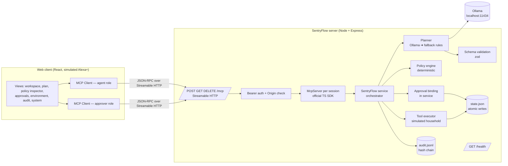
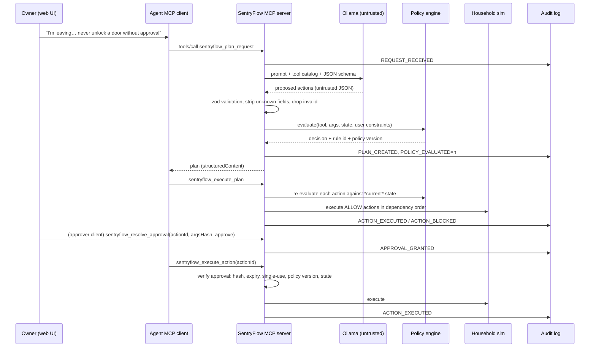

# Architecture

## Components

## Data flow for one request

## Module boundaries (`server/src`)

| Module | Responsibility | Trusts |
|--------|----------------|--------|
| `domain/` | Tool catalog, zod schemas, canonical hashing, dangerous-key checks | — |
| `planner/` | Ollama provider, rule-based fallback, constraint extraction | Nothing it returns is trusted |
| `policy/` | Pure, deterministic rule evaluation | Policy file (validated on load) |
| `environment/` | Simulated household tool executors (also range-check args: defense in depth) | Store |
| `store/` | JSON persistence, atomic write, async mutex | Disk |
| `audit/` | Append-only hash-chained log + verification | Disk |
| `service/` | Orchestrates the lifecycle, including approval binding, expiry and single-use consumption; the **only** caller of executors | All of the above |
| `mcp/` | MCP tool definitions, role checks, result formatting | Service |
| `http/` | Express app, Streamable HTTP transport, auth, Origin check, health | — |

The web client (`web/src`) contains **no authorization logic**. It renders state returned by MCP
tool calls and sends user intent back. Removing the UI does not weaken any guarantee.

## Roles

| Role | Credential | Can | Cannot |
|------|-----------|-----|--------|
| `agent` | `SENTRYFLOW_AGENT_TOKEN` | plan, inspect, edit args, request approval, execute | resolve approvals |
| `approver` | `SENTRYFLOW_APPROVER_TOKEN` | everything `agent` can read, resolve approvals | — |

Separating the roles means an agent that is prompt-injected into calling
`sentryflow_resolve_approval` gets a `FORBIDDEN` error rather than approving its own action.

## Persistence

* `data/state.json` — devices, plans, approvals. Written atomically (temp file + rename) behind a
  single async mutex; the server is single-process by design.
* `data/audit.jsonl` — one JSON record per line; each record carries `prevHash` and
  `hash = SHA-256(prevHash ‖ canonical(record))`. See THREAT_MODEL.md for what this does and does
  not guarantee.

## Why these choices

* **Express + official SDK `StreamableHTTPServerTransport`**: the SDK implements session headers,
  protocol version negotiation, SSE framing and JSON-RPC errors; we would get those wrong by hand.
* **JSON file store instead of SQLite**: Node 20 has no built-in SQLite and native modules are a
  common Windows install failure. The data set is tiny and single-writer.
* **Two MCP connections in the browser**: makes the agent/approver separation visible and real.
